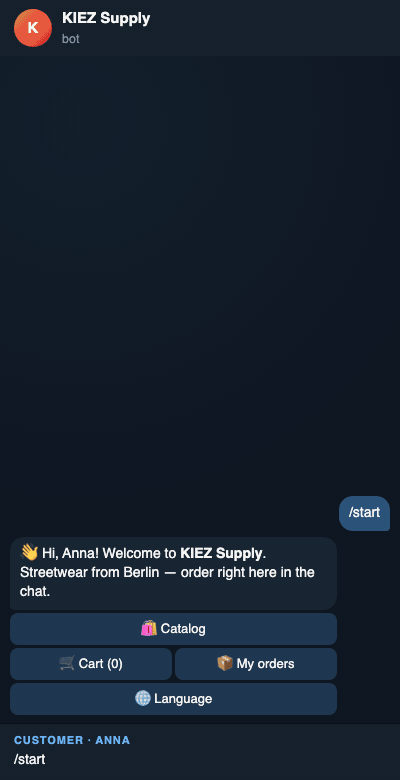
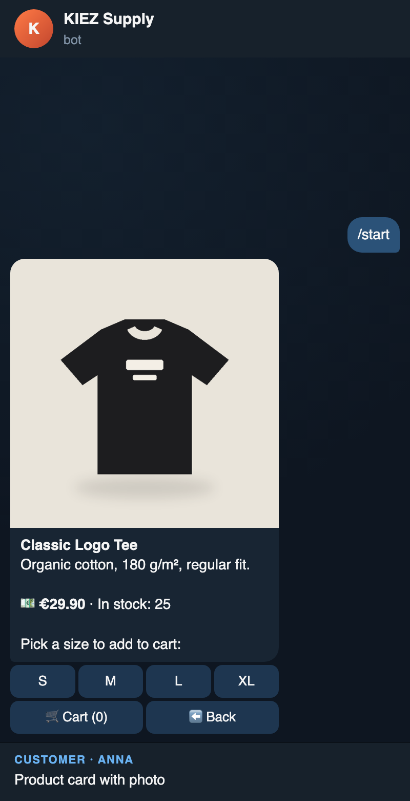
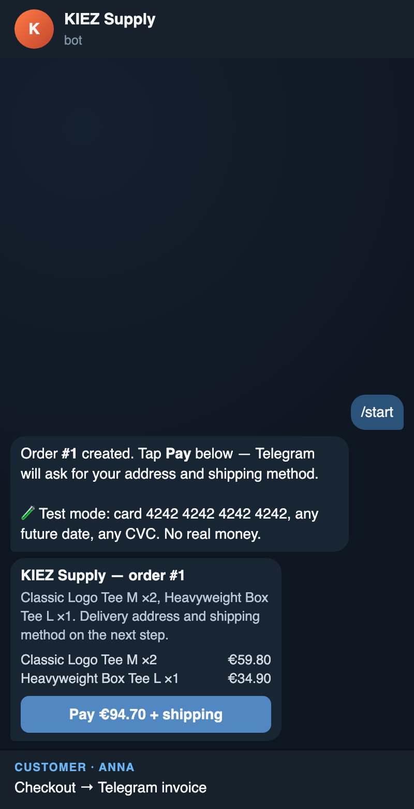
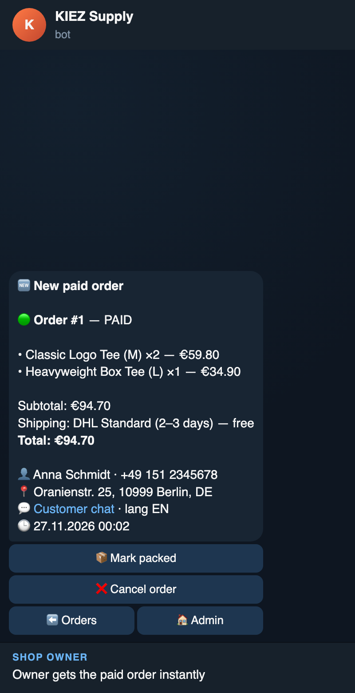
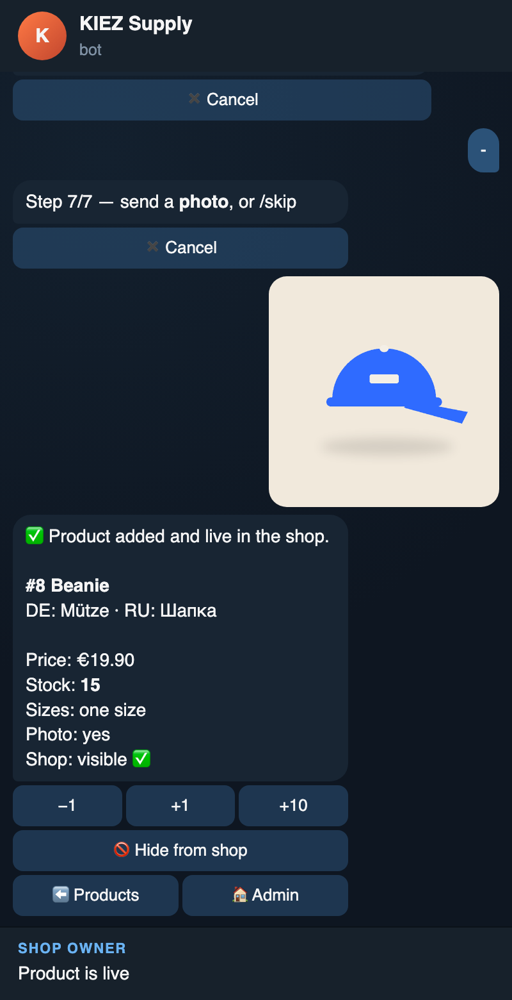
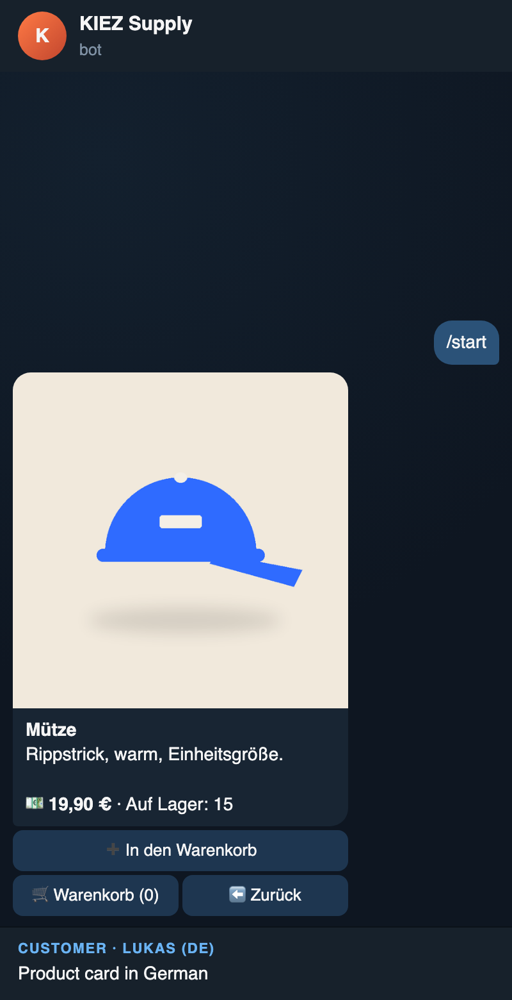
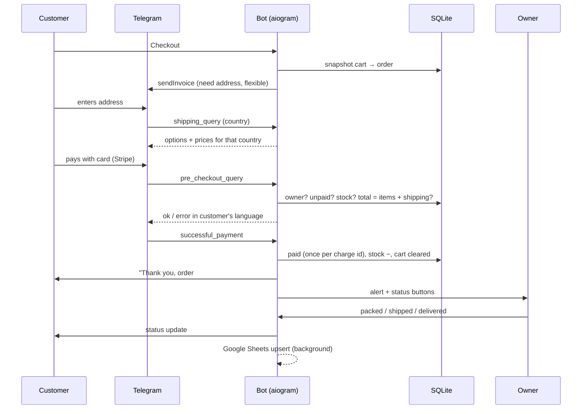

# Telegram Store Bot with card payments and admin panel

A Telegram shop for a small brand: catalog with photos and sizes, cart, **card payments with Telegram Payments (Stripe)**, shipping calculated by country, an **admin panel inside the bot** (orders by status, add products, stock), order export to **CSV / Google Sheets**, and **English / German / Russian**.

Python 3.10+, aiogram 3, SQLite, Docker. Everything below runs **without a Telegram token**: the tests and the demo drive the real handlers through a built-in Telegram emulator.



*Rendered by [`tools/render_chat.py`](tools/render_chat.py) from a real run of the bot's handlers (no mock-ups): a customer buys two T-shirts and pays with the Stripe test card, the owner gets the order and ships it, the customer is notified, the owner adds a product from the chat, a German-speaking customer sees it in German.*

## Problem

A small shop sells through Instagram and DMs. Every order is a manual chat: "which sizes do you have?", "how much is shipping to Austria?", "send me your address", "here is my PayPal". Orders get lost between chats, nobody knows what is paid and what is shipped, and the owner can't add a new product without a developer.

## Solution

**For customers**
- 🛍 Catalog with categories, product photos, descriptions, prices and stock. Sold-out items stay visible but can't be bought.
- 👕 Sizes per product (S/M/L/XL or one size). Stock is shared by all sizes of a product, so the cart can never exceed it.
- 🛒 Cart with ➕/➖, live subtotal, clear.
- 💳 Native Telegram checkout: Telegram's own payment form asks for name, phone and shipping address, then shows **shipping options for that country** (Germany: DHL Standard, free from €80, or Express; EU; worldwide). Card payment through **Stripe** (or any Telegram payment provider).
- 📦 "My orders" with live status; a push message on every status change (packed, shipped, delivered).
- 🌐 EN / DE / RU: picked automatically from the Telegram app language, can be switched anytime (`/language`). Prices are formatted per language (`€29.90` / `29,90 €`).

**For the shop owner (admin panel in the same bot, only for `ADMIN_IDS`)**
- 🆕 Instant alert for every paid order: items, sizes, total, shipping method, name, phone, address, link to the customer chat.
- One-tap status buttons: paid → packed → shipped → delivered (or cancel). Invalid jumps are blocked; cancelling a paid order returns the stock.
- `/admin` dashboard: revenue, how many orders to pack / to ship, orders by status.
- ➕ **Add product wizard** in 7 steps: category, name (one for all languages or `EN | DE | RU`), description, price (`29.90` or `29,90`), stock, sizes, photo. Every input is validated; the product goes live immediately.
- 🗂 Products list: stock +1 / +10 / −1, hide or show in the shop.
- 📤 Export all paid orders to CSV (opens correctly in Excel with umlauts and Cyrillic).
- 📊 Optional live **Google Sheets** sync: every paid order and every status change is upserted into a sheet ([`apps_script.gs`](apps_script.gs), no Google Cloud project needed).

**Payment safety**
- The order is a snapshot of the cart. Starting a new checkout cancels the previous unpaid order, so an old invoice can't be paid later.
- Pre-checkout check right before Telegram charges the card: order belongs to this user, still unpaid, currency matches, **total = items + the shipping price for that country**, and every item is still in stock. Otherwise the customer sees a clear error in their language and is not charged.
- A payment that Telegram delivers twice is applied once (unique `telegram_payment_charge_id`): no double stock decrease, no second admin alert.
- No secrets in code: tokens only from environment variables (`.env.example` is in the repo, `.env` is git-ignored). User input is HTML-escaped.

| Product card | Cart → invoice | Owner alert | Add product | German customer |
|---|---|---|---|---|
|  |  |  |  |  |



## Try it offline (no token, no network)

```bash
python3 -m venv .venv && source .venv/bin/activate
pip install -r requirements-dev.txt

python -m store_bot --demo      # scripted run: purchase, payment, owner ships, owner adds a product
python -m store_bot --console   # play it yourself: type a button number, text, /pay DE, /owner, /me
python -m pytest -q             # 33 tests
```

Part of the `--demo` output:

```
=== Owner chat ===
  🤖 🆕 New paid order
     🟢 Order #1 — PAID
     • Classic Logo Tee (M) ×2 — €59.80
     • Heavyweight Box Tee (L) ×1 — €34.90
     Subtotal: €94.70
     Shipping: DHL Standard (2–3 days) — free
     Total: €94.70
     👤 Anna Schmidt · +49 151 2345678
     📍 Oranienstr. 25, 10999 Berlin, DE
       [📦 Mark packed]
       [❌ Cancel order]
       [⬅️ Orders] [🏠 Admin]
  💬 toast: Order #1 → packed
  💬 toast: Order #1 → shipped

=== Customer chat ===
  🤖 🔔 Order #1: packed 📦
  🤖 🔔 Order #1: shipped 🚚
```

## Run it with a real bot (test payments, no real money)

1. Create a bot with [@BotFather](https://t.me/BotFather) → copy the token.
2. In BotFather: your bot → **Payments** → **Stripe** → **Connect Stripe TEST**. You get a test provider token like `123456789:TEST:...`.
3. Get your Telegram user ID (for example from @userinfobot).
4. Configure and start:

```bash
cp .env.example .env    # BOT_TOKEN, ADMIN_IDS, PAYMENT_PROVIDER_TOKEN
python -m store_bot
```

Pay with the Stripe test card `4242 4242 4242 4242`, any future date, any CVC. When the shop goes live, replace the TEST provider token with the LIVE one and set `PAYMENTS_TEST=0`.

### Docker

```bash
cp .env.example .env
docker compose up -d --build        # data (SQLite) is kept in ./data
docker build --target test .        # runs the test suite inside the image
```

Without `BOT_TOKEN` the container runs the offline demo instead of crashing.

### Google Sheets (optional)

Open a Google Sheet → Extensions → Apps Script → paste [`apps_script.gs`](apps_script.gs) → set the script property `SECRET` → deploy as a web app. Put the `/exec` URL into `SHEETS_WEBHOOK_URL` and the same secret into `SHEETS_SECRET`. The bot never waits for Google: rows are pushed in the background with retries, and SQLite stays the source of truth (the CSV export always works).

## Configuration

| Variable | Meaning |
|---|---|
| `BOT_TOKEN` | Token from @BotFather. Empty → offline emulator |
| `ADMIN_IDS` | Comma-separated Telegram user IDs: order alerts and `/admin` |
| `PAYMENT_PROVIDER_TOKEN` | Telegram Payments provider token (Stripe TEST for demos) |
| `CURRENCY` | `EUR` by default |
| `PAYMENTS_TEST` | `1` shows the test card hint at checkout |
| `FREE_SHIPPING_DE_CENTS` | Free standard shipping in Germany from this subtotal, default `8000` (€80) |
| `SHOP_NAME`, `DEFAULT_LANG` | Shop name in texts; fallback language |
| `DB_PATH` | SQLite file, default `data/store.db` |
| `SHEETS_WEBHOOK_URL`, `SHEETS_SECRET` | Optional Google Sheets sync |
| `TEST_MODE` | `1` forces the emulator even with a token |

## Project layout

```
store_bot/
  cart.py          cart rules: sizes, shared stock, totals (no Telegram code)
  orders.py        order snapshot, shipping zones, pre-checkout checks, idempotent payment, status workflow
  db.py            SQLite schema, demo catalog, per-language product fields
  i18n.py          EN/DE/RU texts, language detection, price formatting
  export.py        CSV export, Google Sheets sync with retries
  keyboards.py     inline keyboards, callback data
  handlers/shop.py customer flow + Telegram Payments (shipping, pre-checkout, successful payment)
  handlers/admin.py admin panel, add-product wizard (FSM), status changes, export
  emulator.py      fake Telegram Bot API session + update builders (tests, demo, console)
  demo.py          scripted demo and interactive console
tests/             33 pytest tests: logic + end-to-end bot flows
tools/             render_chat.py (screenshots + GIF), make_assets.py (demo product images)
apps_script.gs     Google Sheets web app
```

## Tests

```
test_logic.py      cart (sizes, shared stock, hidden products, localized names), shipping zones,
                   order snapshot, stale invoice rejected, pre-checkout (wrong total, wrong zone,
                   other user, currency, sold out), idempotent payment, status workflow,
                   cancel returns stock, CSV, admin input parsers, every text in 3 languages
test_bot_flows.py  full purchase → owner alert → packed/shipped/delivered → customer notified → Sheets rows;
                   US shipping total; duplicate payment update; sold out between invoice and payment
                   (German error text); language autodetect + switch; sold-out card; admin is private;
                   add-product wizard with photo → visible to a German customer; stock/hide/CSV export;
                   checkout refused when payments are not configured

33 passed in 0.13s
```

## Adapting it to a shop

- Catalog: add products from the bot (`/admin` → ➕ Add product), or edit `SEED_PRODUCTS` in `store_bot/db.py`.
- Shipping zones and prices: `shipping_rates()` in `store_bot/orders.py`.
- Texts and languages: `store_bot/i18n.py` (a test fails if a language or placeholder is missing).
- Production: switch FSM storage to Redis and SQLite to PostgreSQL if you run several instances; webhooks instead of polling if you prefer.

See also [telegram-shop-bot](https://github.com/DanyloSkrypka/telegram-shop-bot): a variant with Telegram Stars payments and AI product answers.

## License

MIT
